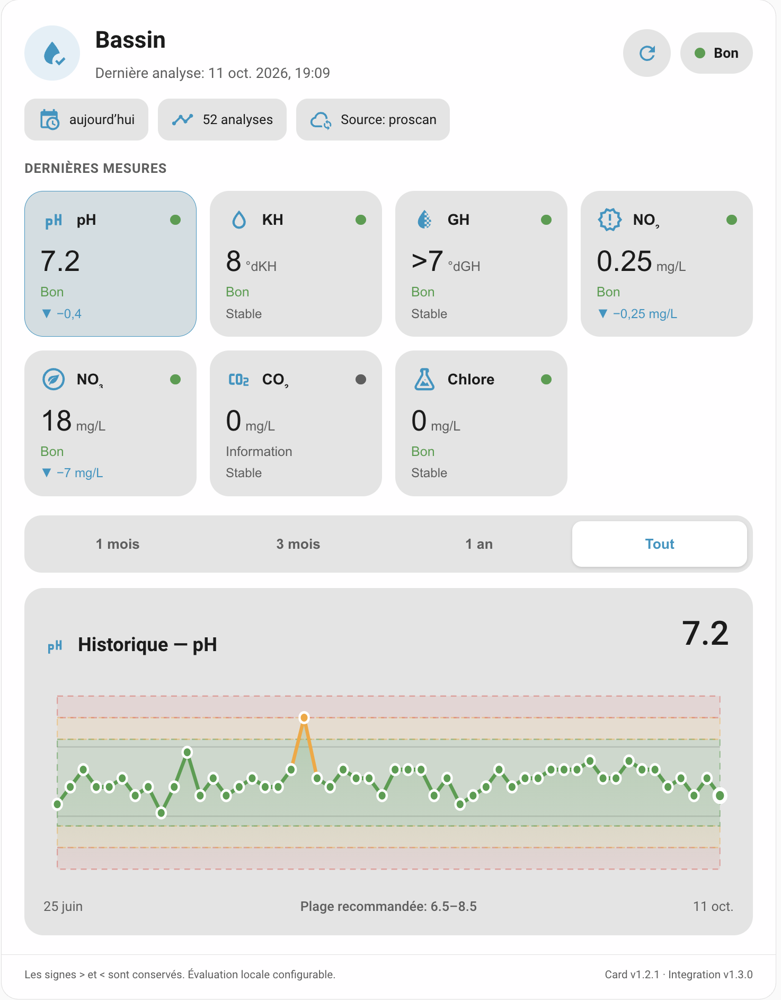
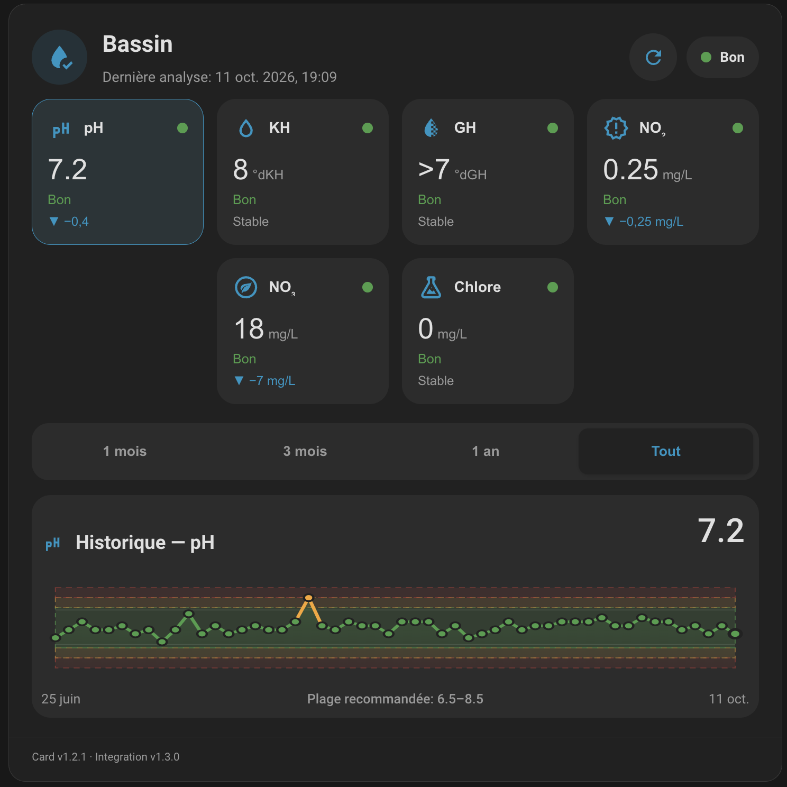

# 🐠 Carte Lovelace JBL ProScan

[![GitHub Release][releases-shield]][releases]
[![License][license-shield]](LICENSE)
[](https://www.home-assistant.io/)
[](https://hacs.xyz/)
[](https://github.com/AuroreVgn)
[](https://ko-fi.com/aurorevgn)

## 🌍 Other languages

[English](README.en.md)

## 🏠 Mes projets Home Assistant

Retrouvez toutes mes intégrations et mes projets sur ma page dédiée : [**🏠 Découvrir mes projets Home Assistant**](https://erra.me)

## ☕ Soutenir le projet

Si cette carte vous est utile et que vous souhaitez soutenir son développement et sa maintenance :

<p>
  <a href="https://ko-fi.com/aurorevgn">
    
  </a>
</p>

## 📑 Sommaire

- [⚠️ Important](#toc-section-1)
- [✨ Fonctionnalités](#toc-section-2)
- [📦 Installation](#toc-section-3)
- [⚙️ Configuration](#toc-section-4)
- [🎛️ Seuils de qualité de l'eau](#toc-section-5)
- [📸 Aperçus](#toc-section-6)
- [🎨 Éditeur visuel](#toc-section-7)
- [📈 Tableau de bord interactif](#toc-section-8)
- [⚙️ Personnalisation](#toc-section-9)
- [🧩 Intégration associée](#toc-section-10)
- [📄 Licence](#toc-section-11)

<a name="toc-section-1"></a>

## ⚠️ Important


Une carte Lovelace moderne pour l'intégration Home Assistant **JBL ProScan**.

➡️ **Intégration nécessaire :** https://github.com/AuroreVgn/JBL_ProScan

<a name="toc-section-2"></a>

## ✨ Fonctionnalités

- 🎨 Design inspiré de Mushroom
- 📱 Interface responsive
- 🌍 Traductions disponibles (🇫🇷 🇬🇧 🇩🇪 🇪🇸 🇮🇹 🇳🇱 🇵🇹)
- 🧩 Éditeur visuel Home Assistant
- 🌞 Thèmes clair et sombre
- 🔄 Bouton d'actualisation manuelle
- 📊 Graphique historique interactif
- 📈 Statistiques longue durée Home Assistant
- 📅 Sélection de la période historique
- 🔍 Infobulles interactives
- 📉 Plages recommandées JBL
- 🔄 Comparaison avec l'analyse précédente
- 🎨 Sélecteur de couleurs natif Home Assistant
- 🎭 Sélecteur d'icônes natif Home Assistant
- ⚙️ Personnalisation avancée

<a name="toc-section-3"></a>

## 📦 Installation

> [!NOTE]
> **Marketplace / HACS — Home Assistant 2026.11+ :** ouvrez **Paramètres → Marketplace**, intégré à Home Assistant sans installation séparée de HACS. Recherchez ce projet ou ajoutez `https://github.com/AuroreVgn/JBL-ProScan_card` comme **dépôt personnalisé** s'il n'est pas encore référencé. Avec Home Assistant **2026.10 ou antérieur**, continuez à utiliser HACS comme indiqué ci-dessous. Les liens `hacs_repository` existants restent compatibles. Après installation, ajoutez la carte à votre tableau de bord. Le projet reste communautaire et non officiel.
>
> **EN:** Starting with Home Assistant **2026.11**, use the built-in **Settings → Marketplace**, with no separate HACS installation. Search for the project or add its GitHub URL as a **custom repository**. On **2026.10 or earlier**, continue using HACS. Existing `hacs_repository` links remain compatible. This is a community project, not an official Home Assistant integration.


### HACS (recommandé)

#### Ajouter le dépôt à HACS

##### Automatiquement

[](https://my.home-assistant.io/redirect/hacs_repository/?owner=AuroreVgn&repository=JBL_ProScan_card&category=plugin)

##### Manuellement

```text
HACS
 └── Tableaux de bord
      └── ⋮
           └── Dépôts personnalisés

Dépôt
https://github.com/AuroreVgn/JBL_ProScan_card

Catégorie
Dashboard
```

#### Télécharger

```text
HACS
 └── JBL ProScan Card
      └── Télécharger
```

Redémarrez Home Assistant si nécessaire.

<a name="toc-section-4"></a>

## ⚙️ Configuration

Configuration minimale :

```yaml
type: custom:jbl-proscan-card
entity: sensor.bassin_historique
```

Remplacez `sensor.bassin_historique` par l'identifiant de votre capteur historique si celui-ci est différent.

<a name="toc-section-5"></a>

## 🎛️ Seuils de qualité de l'eau

Chaque mesure et chaque point du graphique historique reçoivent individuellement une couleur selon les seuils ci-dessous.

> Les valeurs exactement égales aux limites de la plage recommandée sont considérées comme conformes et affichées en 🟢 vert.

| Paramètre | 🟢 Bon | 🟠 À surveiller | 🔴 Mauvais |
|---|---|---|---|
| **pH** | 6,5 ≤ pH ≤ 8,5 | 6,0 ≤ pH < 6,5 ou 8,5 < pH ≤ 9,0 | pH < 6,0 ou pH > 9,0 |
| **KH** | 5 ≤ KH ≤ 15 °dKH | 3 ≤ KH < 5 ou 15 < KH ≤ 20 °dKH | KH < 3 ou KH > 20 °dKH |
| **GH** | 4 ≤ GH ≤ 21 °dGH | 2 ≤ GH < 4 ou 21 < GH ≤ 28 °dGH | GH < 2 ou GH > 28 °dGH |
| **NO₂** | 0 ≤ NO₂ ≤ 0,25 mg/L | — | NO₂ > 0,25 mg/L |
| **NO₃** | NO₃ ≤ 25 mg/L | 25 < NO₃ ≤ 50 mg/L | NO₃ > 50 mg/L |
| **CO₂** | Information uniquement | — | — |
| **Chlore** | 0 ≤ Chlore ≤ 0,8 mg/L | — | Chlore > 0,8 mg/L |

<a name="toc-section-6"></a>

## 📸 Aperçus

| Mode clair | Mode compact |
| :---: | :---: |
|  |  |

<a name="toc-section-7"></a>

## 🎨 Éditeur visuel

La carte est compatible avec l'éditeur visuel Home Assistant.

Options disponibles :
- Titre
- Longueur de l'historique
- Nombre de mesures affichées
- Mode compact
- Affichage du CO₂
- Seuils de qualité de l'eau
- Bouton d'actualisation manuelle
- Sélecteur de période historique
- Couleurs personnalisées
- Icônes personnalisées
- Plages recommandées JBL

Pour la plupart des utilisateurs, aucune modification YAML n'est nécessaire.

<a name="toc-section-8"></a>

## 📈 Tableau de bord interactif

La carte propose :
- 📊 Vue d'ensemble de la qualité de l'eau
- 📈 Graphiques historiques
- 📅 Périodes sélectionnables : 1 mois, 3 mois, 1 an ou tout l'historique
- 🔄 Actualisation manuelle
- 📉 Comparaison avec l'analyse précédente
- 📍 Plages recommandées JBL
- 🖱 Infobulles interactives détaillées
- 📊 Prise en charge des statistiques Home Assistant

<a name="toc-section-9"></a>

## ⚙️ Personnalisation

L'apparence se personnalise directement dans l'éditeur visuel.

### Couleurs
- Couleur principale
- Bon
- À surveiller
- Critique

Ces couleurs utilisent le sélecteur natif Home Assistant.

### Icônes

Le sélecteur natif Home Assistant permet de personnaliser les icônes :
- En-tête
- Actualisation
- pH
- KH
- GH
- NO₂
- NO₃
- CO₂
- Chlore

<a name="toc-section-10"></a>

## 🧩 Intégration associée

Cette carte nécessite l'intégration **JBL ProScan**.

➡️ https://github.com/AuroreVgn/JBL_ProScan

<a name="toc-section-11"></a>

## 📄 Licence

Distribué sous licence MIT.

[releases-shield]: https://img.shields.io/github/v/release/AuroreVgn/JBL_ProScan_card?style=flat-square
[releases]: https://github.com/AuroreVgn/JBL_ProScan_card/releases
[license-shield]: https://img.shields.io/github/license/AuroreVgn/JBL_ProScan_card?style=flat-square
